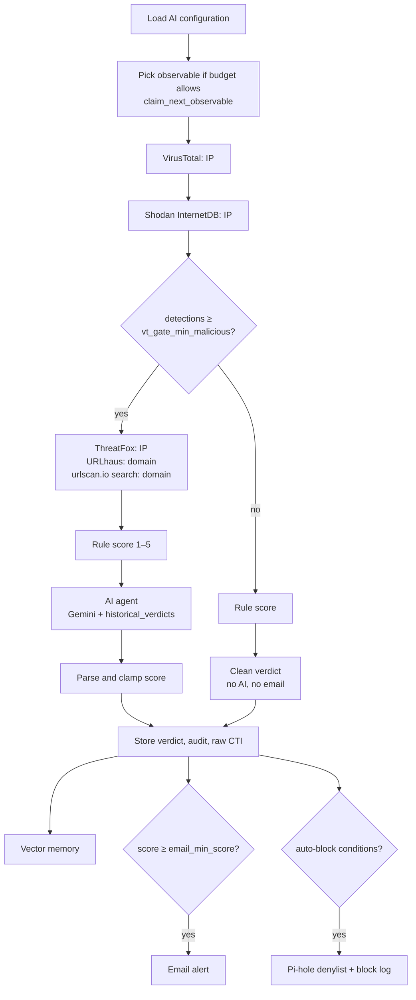
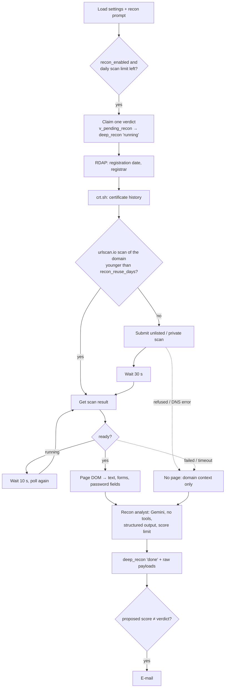
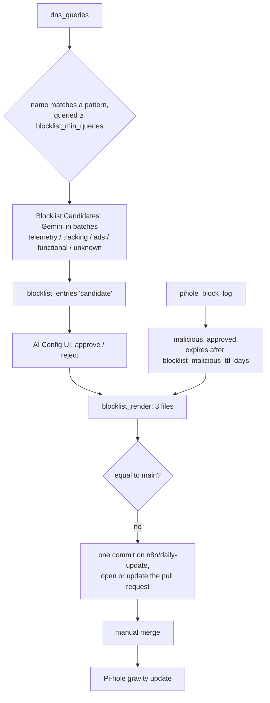

# n8n Workflows

Four workflows in [`config/n8n/workflows/`](https://github.com/lukaszFD/cyber-sentinel/tree/main/config/n8n/workflows), all imported by playbook 04.6:

- **Automated Domain & IP Reputation Guard** — the main pipeline. Runs every minute and analyses one observable — a domain and the IP it resolved to — per run, as long as the VirusTotal budget allows it (see [VirusTotal Budget](#virustotal-budget)).
- **Deep Recon** — runs hourly (at :20) after the verdict: domain age, certificate history and the web page of high-scored domains, then an AI re-assessment. See [Deep Recon](#deep-recon).
- **Blocklist Candidates** and **Blocklist Publish** — daily (03:20 and 05:20): own Pi-hole blocklists for malicious, tracking and telemetry domains, published to [sentinel-blocklists](https://github.com/lukaszFD/sentinel-blocklists). See [Own Blocklists](#own-blocklists).

An earlier version is published in the n8n library: [Score DNS Threats with VirusTotal, Abuse.ch, HashiCorp Vault, and Gemini](https://n8n.io/workflows/14127-score-dns-threats-with-virustotal-abusech-hashicorp-vault-and-gemini/).

## Flow

## Steps

1. **Load configuration** — one query reads all `ai_settings`, the threat scale and the active prompt. Every threshold below comes from there and is edited in the AI Config UI.
2. **Pick observable** — `claim_next_observable()` returns the next row of `v_pending_observables`, or nothing when the VirusTotal budget is used up. Private IPs, allow-listed domains and pairs analysed in the last `cache_ttl_days` are already filtered out.
3. **VirusTotal** — VirusTotal checks the IP. A failed lookup (quota, auth, server error) is never scored as clean: the run fails and the observable is retried later.
4. **Shodan and the gate** — every IP is also looked up in Shodan InternetDB (switch `shodan_internetdb_enabled`): open ports, software, known CVEs, tags and the hostnames Shodan saw on the IP. Free, no API key, no quota; weekly snapshot, non-commercial use only. It is context for the AI agent and the e-mail and does not change the rule score. Below `vt_gate_min_malicious` detections the observable is then scored by rules only and stored as clean: no further API calls, no AI tokens, no email.
5. **Enrich** — ThreatFox (by IP), URLhaus (by domain) and two urlscan.io searches (switch `urlscan_search_enabled`, scans younger than `urlscan_search_days`): earlier scans of the domain's page (title, HTTP status, TLS issuer and certificate age, urlscan's verdict) and other sites urlscan saw on the same IP (malicious ones first). All are supporting sources; urlscan.io is only searched, nothing is submitted, and nothing here changes the rule score.
6. **Rule score** — `compute_threat_score()` in PostgreSQL turns the results into a score 1–5 with a step-by-step trace.
7. **AI agent** — reviews the evidence and the rule score (details below).
8. **Store** — raw responses, verdict, audit record and the embedding for vector memory.
9. **Act** — email and Pi-hole auto-block (details below).

## VirusTotal Budget

The public API allows 4 requests per minute and 500 per day; the daily quota resets at 00:00 UTC. The workflow runs every minute, and `claim_next_observable()` decides whether this run may call VirusTotal:

| Setting | Default | Meaning |
|---|---|---|
| `vt_daily_limit` | 500 | Calls per day. At the limit the workflow stops until the reset. |
| `vt_per_minute_limit` | 4 | Calls in the last 60 seconds. Matters when runs overlap or the schedule runs more often than once a minute. |
| `vt_reserve_per_hour` | 5 | Calls kept back per hour left until the reset, for traffic that arrives later. 0 = spend the budget as soon as there is work. |

A backlog is therefore cleared at up to 60 observables per hour instead of being spread over the day, while the reserve keeps calls for the evening and night. Every call is logged in `vt_lookup_log`; the same row stops two overlapping runs from taking the same observable. If a run fails before storing a verdict (e.g. VirusTotal returns 429), the pair is picked up again after 15 minutes.

Calls made by the live lookups in the AI Config UI simulator are not counted — keep `vt_daily_limit` a little below the real quota if you use them often. To clear a backlog faster than 60 per hour, set the Schedule Trigger to run every 15–20 seconds; the per-minute limit still holds.

## Rule Score

| Step | Rule |
|---|---|
| 1 | VirusTotal detections → CLEAN / LOW / MEDIUM / HIGH (`vt_low_max`, `vt_medium_max`); trusted infrastructure with ≤ `vt_big_player_noise_max` detections is CLEAN |
| 2 | ThreatFox → CLEAN (not listed), MEDIUM (listed), HIGH (listed and seen in the last `tf_active_days`) |
| 3 | Combine: active ThreatFox IOC with a malware family or ≥ `tf_active_vt_min` detections → 5; any HIGH or hits in both → 4; MEDIUM → 3; LOW → 2; else 1 |
| 4 | URLhaus: +1 when the base is ≥ 3 and the domain has online malicious URLs |
| 5 | Trusted infrastructure without a ThreatFox malware family is capped at 2 |

## AI Agent

| | |
|---|---|
| Model | Gemini 3.1 Flash Lite, temperature 0.2 |
| Prompt | Active version from `prompt_templates`; threat scale and `ai_max_deviation` injected at run time. Version 1.2 (inactive draft) also describes the urlscan.io and Shodan evidence — activate it in the AI Config UI |
| Input | Observable, VirusTotal / ThreatFox / URLhaus / urlscan.io / Shodan evidence, rule score with its trace |
| Tool | `historical_verdicts` — similarity search over past verdicts in pgvector, called once |
| Output | Structured JSON: label, English summary, primary evidence, supporting context, Polish analysis, proposed score, reason for any deviation, cited past verdicts |

The agent explains the rule score and may change it only for a reason visible in the evidence. The workflow then enforces the limits itself:

- the final score stays within `ai_max_deviation` of the rule score, whatever the model proposes;
- if the agent fails or returns invalid output, the rule score is stored with `ai_status = failed` — nothing is lost;
- cited past verdicts are kept only if they exist;
- evidence from the internet is treated as data; the prompt forbids following instructions found in it.

Every verdict is recorded in `verdict_audit`: rule score, final score, deviation reason, model and prompt version. Successful verdicts are embedded and added to `verdict_vectors`, so the next analysis can find them.

## Actions

**Email** — sent when the AI analysed the observable and the final score is ≥ `email_min_score`. Colour follows severity; all values are HTML-escaped. The urlscan.io block shows earlier scans of the page, the TLS certificate issuer and age, and other sites on the same IP; the Shodan block shows open ports, the hostnames on the IP and the software. Known CVEs stay in the data for the AI agent but are not e-mailed — InternetDB derives them from software versions, so they are noisy.

**Pi-hole auto-block** — the domain is added to Pi-hole's exact denylist when all of these hold:

- `pihole_block_enabled = 1`,
- VirusTotal answered and detections ≥ `pihole_block_min_vt_malicious`,
- the IP is not trusted infrastructure.

The workflow logs in with a Pi-hole application password, adds the domain with a comment, logs out and writes the result (`blocked`, `already_blocked` or `error`) to `pihole_block_log`. To unblock, remove the domain in Pi-hole.

## Deep Recon

Runs hourly at minute 20. For verdicts with a final score ≥ `recon_min_score` (from the last `recon_lookback_days`) it collects what the main workflow does not, and lets an AI analyst re-assess the verdict. Verdicts are never changed automatically.

- **Queue** — `v_pending_recon`. A verdict is claimed with a `running` row before any external call, so a failing domain is never retried in a loop. A domain with a recent recon is skipped, so several verdicts of one domain lead to one recon. Re-queue from the AI Config UI (Deep recon page).
- **Domain** — RDAP (`rdap.org`, no key) is asked for two candidates, the last three and the last two labels of the domain; the longest one the registry knows is the registered domain (`shop.firma.com.pl` → `firma.com.pl`). Some TLDs have no RDAP: then the domain age is unknown. For subdomains of platforms on the allow-list exclusions (`github.io`, `ngrok.io`, …) the registration describes the platform, which the analyst is told.
- **Certificates** — crt.sh (Certificate Transparency, no key): number of certificates, first and latest, issuers, names. crt.sh is often slow; a failure is recorded and the run goes on.
- **Page** — the page's TLS certificates (subject, issuer, validity) and the domains it loads resources from are extracted from the scan; the other sites on the same IP come from the verdict. urlscan.io scan reused when younger than `recon_reuse_days`, otherwise submitted (unlisted, or private with `recon_private_scans`). At most `recon_daily_limit` new scans per day; urlscan.io free plan: 1000 unlisted or 50 private per day. Without a page (no key, refused, domain gone, timeout) the analyst still runs on the domain context.
- **Recon analyst** — prompt from `recon_prompt_templates` (versioned, edited in the AI Config UI; `[[THREAT_SCALE]]` and `[[MAX_DEVIATION]]` resolved at run time). Input: the verdict as stored, RDAP, crt.sh and page facts with up to 6000 characters of page text. Output: page type, impersonated brand, credential harvesting, confirms / contradicts / inconclusive, confidence, proposed score with reason, indicators, English summary, Polish analysis. The workflow keeps the proposed score within `recon_max_deviation` of the verdict, whatever the model says; a failed or invalid answer still saves the facts with `ai_status = failed`.
- **Untrusted page** — the page is attacker-controlled. Its text is passed only as data, comments and scripts are stripped, URLs are defanged, the model has no tools, and e-mail links point only to urlscan.io.
- **Result** — `deep_recon`, one row per verdict. Raw RDAP and urlscan.io payloads go to `threat_data_raw` and are linked to the verdict's indicator. When the proposed score differs (`score_changed`) and `recon_email_enabled = 1`, an e-mail shows both scores, the reason, the page and the domain history.

## Own Blocklists

Domains that get through Pi-hole but should not — malicious ones the main workflow blocked, telemetry and tracking — are published as plain domain lists to the public repository **lukaszFD/sentinel-blocklists**. Pi-hole pulls them as adlists. The database is the source of truth; the files are generated from it.

- **Lists** — `lists/malicious.txt`, `lists/tracking.txt`, `lists/telemetry.txt`: one domain per line, exact match, no IPs.
- **Candidates** — domains with a public IPv4 answer in the last `blocklist_lookback_days`, queried at least `blocklist_min_queries` times, whose name contains an active pattern (`blocklist_name_patterns`), not classified yet and not on any list. At most `blocklist_ai_daily_limit` per day, `blocklist_ai_batch_size` per request. No VirusTotal calls. Answers about domains that were not in the batch are dropped.
- **Review** — telemetry and tracking at or above `blocklist_ai_min_confidence` wait for approval on the Blocklists page; an e-mail announces them. Rejected domains are kept and never proposed again.
- **Malicious** — every Pi-hole auto-block is copied as approved; a new block extends the expiry. A rejected malicious domain stays rejected.
- **Protection** — a domain covered by a manual allow-list entry is never published. Tranco entries and trusted infrastructure do not protect: telemetry usually sits on popular vendor domains.
- **Publish** — the branch `n8n/daily-update` is rebuilt from `main` every run with the full generated files, so one pull request always shows the whole difference. A pull request left open after the lists became equal to `main` again is closed. The merge stays manual: a ruleset on `main` requires a pull request. `blocklist_publish_enabled = 0` (default) is a dry run — compared and logged only. Every run is logged in `blocklist_publish_log`; a new or updated pull request and errors are e-mailed.

## Secrets

The workflows read secrets from HashiCorp Vault at run time:

| Vault path | Used for |
|---|---|
| `cyber-sentinel/credentials/postgres/app_manager` | PostgreSQL |
| `cyber-sentinel/api-keys/virustotal` | VirusTotal |
| `cyber-sentinel/api-keys/abuse/api-key` | ThreatFox, URLhaus |
| `cyber-sentinel/api-keys/gemini/home-network-guardian` | Gemini |
| `cyber-sentinel/credentials/gmail` | Email: SMTP login and alert recipient (`to`) |
| `cyber-sentinel/credentials/pihole-api` | Pi-hole API |
| `cyber-sentinel/api-keys/urlscanio/api-key` | urlscan.io search (main) and page scans (Deep Recon) |
| `cyber-sentinel/api-keys/github/blocklists` | GitHub fine-grained token for sentinel-blocklists: Contents and Pull requests read/write (Blocklist Publish) |

The n8n credentials needed by the AI and database nodes (Vault token, PostgreSQL, Gemini, SMTP) are created with fixed IDs by playbook 06.2, so the imported workflows work without manual setup.