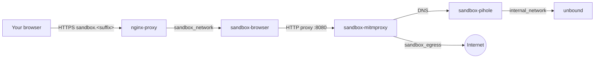

# Browser Sandbox

A "dirty browsing" browser for opening suspicious links. Everything it does is recorded as CTI material: every URL (with headers, redirects and payload hashes) and every DNS query. It is isolated from the LAN and from the rest of the stack.

Deployed by playbooks 04.1 (files), 04.2 (containers) and 04.7 (post-config); Nginx entries in 05.

## Containers

| Container | Image | Networks | Role |
|---|---|---|---|
| `sandbox-browser` | `linuxserver/ungoogled-chromium` | `sandbox_network` `.10` | ungoogled-chromium in the Selkies web viewer (port 3000). Profile on tmpfs, no volumes except the read-only Chromium policy |
| `sandbox-mitmproxy` | `mitmproxy/mitmproxy` | `sandbox_network` `.2`, `sandbox_egress` `.2` | The only way out. Logs every flow, refuses private destinations |
| `sandbox-pihole` | `pihole/pihole` (same pin as the main Pi-hole) | `sandbox_network` `.3`, `internal_network` `.16` | DNS for the sandbox only — **no adlists**, upstream Unbound `10.10.10.2` |

Images are pinned in `ansible/group_vars/all/images.yml` (`sandbox_browser`, `mitmproxy`, `pihole`), multi-arch.

## Networks



- `sandbox_network` (`10.10.20.0/24`) is `internal: true`: no route out. Nginx joins it (`.100`) only to serve the viewer.
- `sandbox_egress` (`10.10.21.0/24`) has only mitmproxy.
- Chromium is forced through the proxy by a managed policy (`ProxySettings`, no bypass, loopback included) and WebRTC may only use the proxy (`WebRtcIPHandling: disable_non_proxied_udp`).
- The mitmproxy addon resolves every destination itself and refuses it when any address is not public (RFC 1918, loopback, link-local, CGNAT, reserved). The checked IP is pinned for the connection, so DNS rebinding cannot reach the LAN, the stack or Nginx. Refused attempts are logged as `blocked`.
- The sandbox never uses the main Pi-hole (`10.10.10.4`), so none of its traffic reaches `cyber_sentinel.dns_queries` or the n8n queue.

Accepted risk: a browser exploit with code execution inside `sandbox-browser` can talk directly to Nginx and the sandbox Pi-hole on `sandbox_network` (nothing else, no internet).

## Using it

| What | Where |
|---|---|
| Browser | `https://sandbox.<suffix>` (no password, LAN only) |
| Sandbox Pi-hole UI | `https://sandbox-dns.<suffix>/admin` (same admin password as the main Pi-hole) |

Both reuse existing certificates (`vault_firefox_*` and `vault_pihole_*`), so the browser warns that the name does not match until dedicated certs are added. Add both names to Local DNS records pointing at the host.

After a session, wipe the browser (profile, tabs, cookies, cache) on the host:

```bash
sudo sandbox-reset
```

Cron runs the same at 04:00 every night. mitmproxy, the sandbox Pi-hole and the logs are kept.

## TLS interception

mitmproxy creates its CA on first start in `config/sandbox/mitmproxy/` on the host (private key stays there, 0600). Playbook 04.7 puts the public certificate into the Chromium policy (`CACertificates`) and recreates the browser when it changes. To rotate the CA, delete `config/sandbox/mitmproxy/mitmproxy-ca*`, restart `sandbox-mitmproxy` and re-run 04.7.

Upstream certificates are **not** enforced (`ssl_insecure`): malicious sites often have self-signed or expired certificates, and seeing them is the point. The addon verifies each upstream chain itself and logs the result in `upstream_tls`.

## Logs

| Log | Host path | Format |
|---|---|---|
| URLs | `config/sandbox/logs/urls.jsonl` | JSON Lines, rotated at midnight, 14 days kept (`urls.jsonl.YYYY-MM-DD`) |
| DNS | `config/sandbox/pihole/log/pihole.log` | Pi-hole query log (extra logging on); the client is always mitmproxy |

One URL record per HTTP flow, error or blocked attempt:

| Field | Meaning |
|---|---|
| `ts` | UTC timestamp |
| `event` | `http`, `error`, `blocked`, `client_tls_failed` |
| `method`, `url`, `scheme`, `host`, `port`, `http_version` | Request |
| `server_ip` | Address actually connected to |
| `status`, `reason`, `content_type`, `redirect_location` | Response |
| `referer`, `user_agent` | Request headers, copied out |
| `req_headers`, `resp_headers` | All headers; `Cookie`, `Set-Cookie`, `Authorization`, `Proxy-Authorization` redacted |
| `size`, `sha256` | Decoded body size and SHA-256; bodies over 20 MB are streamed and not hashed (`streamed: true`). Bodies are never stored |
| `upstream_tls` | Real upstream certificate: subject, issuer, expiry, SHA-256, `verified`, `error` |
| `error` | Error or block reason |

Not in the database yet: ingestion into a separate schema (`cyber_sentinel_sandbox`) and URL checks (URLhaus, ThreatFox, MalwareBazaar, urlscan.io) are the next step.

## Resources

Memory limits: browser 1.5 GB (shared memory 512 MB), mitmproxy 384 MB, Pi-hole 256 MB.
