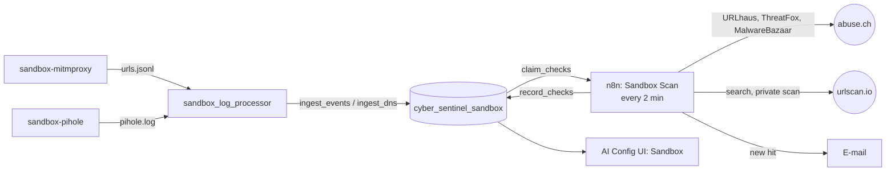

# Data & CTI

What the sandbox saw is stored in its own schema, `cyber_sentinel_sandbox`, and checked against threat intelligence. None of it reaches `cyber_sentinel.dns_queries` or the main n8n queue.

## Flow

## Ingestion

`sandbox_log_processor` (`config/sandbox/processor/`) follows both logs, mounted read-only:

- **Exactly once** — each batch is stored together with the file position (inode + byte offset, `ingest_state`) in one transaction. After a restart it resumes at that position; if the file was rotated meanwhile (`urls.jsonl` → `urls.jsonl.YYYY-MM-DD` at midnight), it finishes the old file first. With no saved position it reads the current file from the start.
- **Least privilege** — its role `sandbox_ingest` (`sandbox_db_user`, password `vault_sandbox_db_password`) may only call `ingest_events()`, `ingest_dns()`, `ingest_skip()` and `ingest_position()`. Those functions cap and type-check every value: the data comes from the browsed sites. The container gets only its own `SANDBOX_DB_*` variables, runs as a non-root user with a read-only file system and no capabilities.
- **Top-level pages** — a request with `Sec-Fetch-Mode: navigate` and `Sec-Fetch-Dest: document` is flagged `is_navigation`, also when the server failed (`error`).
- DNS lines are parsed by the same parser as `dns_log_processor`.

## Schema `cyber_sentinel_sandbox`

Created by `config/postgres/db_sandbox.sql` (playbook 04.3).

| Object | Content | Retention |
|---|---|---|
| `url_events` | One row per mitmproxy record: all fields of `urls.jsonl`, headers and upstream TLS as `jsonb`, `is_navigation` | Monthly partitions, 3 months |
| `dns_queries` | Sandbox Pi-hole queries and answers (`query`, `reply`, `cached`) | Monthly partitions, 3 months |
| `observables` | Unique `host`, `ip`, `url`, `sha256`: first / last seen, count, status, verdict, urlscan state | Kept |
| `observable_checks` | Every lookup: provider, outcome (`hit`, `no_hit`, `pending`, `error`), summary, report link, details | Kept |
| `ingest_state` | Read position of each log | — |
| `v_pending_checks` | Queue: never checked, seen again after `sandbox_recheck_days`, or a private scan waiting for its result | — |
| `v_sessions` / `v_event_sessions` | Traffic split into sessions by a pause longer than `sandbox_session_gap_minutes` | — |
| `v_latest_checks`, `v_urlscan_budget` | Latest result per provider; private scans used today | — |

Both partitioned tables are listed in `cyber_sentinel.partitioned_tables()`, so the monthly pg_cron jobs add and drop their partitions like the others.

### Which observables

| Kind | From | Filter |
|---|---|---|
| `host` | every record (also blocked attempts and errors) | allow-listed (Tranco top N, manual) → `skipped_trusted`, never looked up |
| `ip` | `server_ip` of answered requests | skipped when its host is allow-listed |
| `url` | answered GET / POST / HEAD requests, and top-level pages whose server failed (`error`, e.g. a dead phishing site) | skipped for allow-listed hosts and static assets (images, fonts, CSS, media) unless it was a top-level page |
| `sha256` | response bodies | only types that can carry a payload (executables, archives, documents, scripts, `application/octet-stream`, or such a file extension) — **whatever the host** |

The allow-list status follows changes: an observable seen again after its host was added to or removed from the allow-list gets the new status.

## CTI checks

The n8n workflow **Sandbox Scan** (every 2 minutes, see [n8n → Sandbox Scan](../n8n.md#sandbox-scan)) takes up to `sandbox_scan_batch_size` observables from `claim_checks()` and marks them for 15 minutes, so overlapping runs never take the same one.

| Observable | Lookups |
|---|---|
| host, IP | ThreatFox `search_ioc`, URLhaus `host` |
| URL | URLhaus `url`; top-level pages also urlscan.io |
| SHA-256 | MalwareBazaar `get_info`, ThreatFox `search_hash` |

- **urlscan.io** — only top-level pages: search for scans of the domain in the last 7 days; without one a **private** scan (visible only to the account), at most `sandbox_urlscan_daily_limit` per UTC day. A later run fetches the result; after 15 minutes without one it is marked failed.
- **Verdict** — `hit` when any provider ever reported one, `error` when every abuse.ch lookup of the run failed, else `clean`.
- **Re-check** — only observables seen again after `sandbox_recheck_days`.
- Every request goes to `cyber_sentinel_ai.api_call_log` (caller `sandbox`), so the API usage page and its alerts include the sandbox.
- No VirusTotal and no AI verdict for sandbox data.

## Results

- **AI Config UI → Sandbox** — counters, the urlscan budget, the ingest heartbeat; sessions; the requests and DNS of a session with hits marked; observables with their latest checks and links to the provider reports (only urlscan.io and abuse.ch links are rendered; URLs from browsed sites are text only).
- **E-mail** — one per run for observables that became a hit, URLs defanged (`sandbox_alert_enabled`).

## Blocklist

A hit blocks the host for the whole LAN through the own blocklists ([n8n → Own Blocklists](../n8n.md#own-blocklists)):

- The view `v_blocklist_hits` lists the full host of every observable with verdict `hit` — the host itself, the host of a URL, or the host a payload hash came from (`example_url`). Allow-listed hosts (Tranco top N, manual), IP literals and shared platforms themselves (`domain_allowlist_exclusions`, e.g. `storage.googleapis.com`) are left out; a user's own name under such a platform (`x.sites.google.com`) is blocked.
- **Blocklist Publish** (daily, 05:20) copies them into `cyber_sentinel_ai.blocklist_entries` as `malicious`, `approved`, source `sandbox`, expiring `blocklist_malicious_ttl_days` after the latest hit, and opens or updates the pull request in sentinel-blocklists. The merge stays manual.
- A sandbox entry can be rejected on the Blocklists page like any other; it stays rejected.

## Settings

AI Config UI → Settings → *Browser sandbox*:

| Key | Default | Meaning |
|---|---|---|
| `sandbox_scan_enabled` | 1 | Lookups on / off (traffic is recorded either way) |
| `sandbox_scan_batch_size` | 20 | Observables per run |
| `sandbox_recheck_days` | 7 | Re-check an observable seen again after N days |
| `sandbox_session_gap_minutes` | 30 | Pause that starts a new session |
| `sandbox_urlscan_enabled` | 1 | urlscan.io for top-level pages |
| `sandbox_urlscan_daily_limit` | 20 | Private scans per UTC day (free plan: 50) |
| `sandbox_alert_enabled` | 1 | E-mail on new hits |
